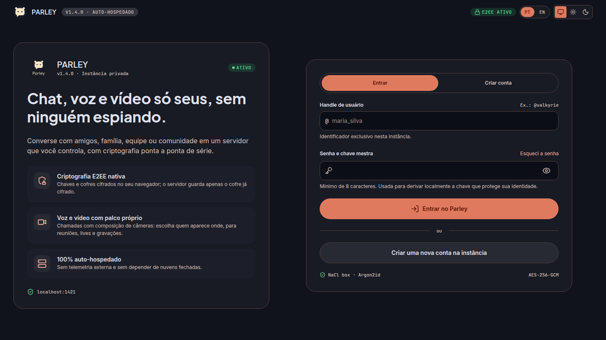
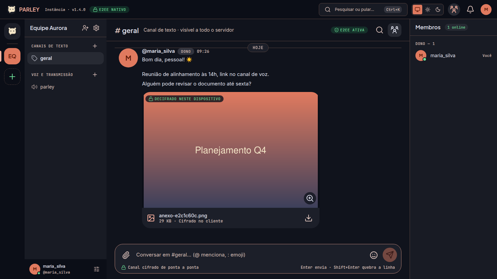
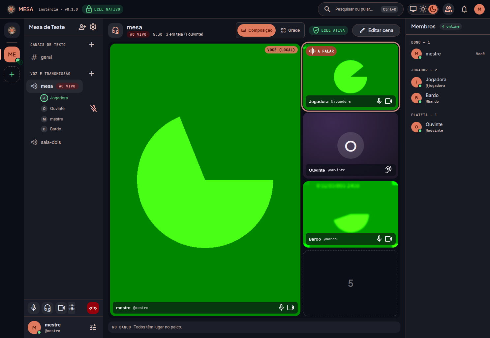
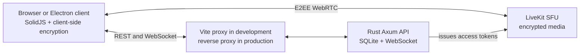

<p align="center">
  
  
</p>

# Parley

> [!IMPORTANT]
> **Official Parley instance:** [parley.1nodado.com.br](https://parley.1nodado.com.br/)
> Access through your browser or use this address to setup the desktop app. If you do this, you'll be using the official server.

The official instance serves a marketing home at `/`; `/login` opens the app. Other instances
keep the existing compact public home. See the [production guide](docs/deploy-producao.md)
for the Nginx routes and rollback.

**Self-hosted chat and video**, in the spirit of Discord, with **native camera composition** and **end-to-end encryption (E2EE) by default**.

Parley gives friends, families, teams, communities, and creators a private instance of their own. Instances do not federate, and the server cannot read conversation content under normal operation.

| | |
|---|---|
| **Status** | **1.12.0** — Rust backend, v2 frontend, and Electron desktop client ([changelog](CHANGELOG.md)) |
| **Download** | [Desktop releases for Windows, macOS, and Linux](https://github.com/ricardopiloto/chat-app/releases) |
| **Stack** | Rust (Axum + SQLite), SolidJS (Vite + Tailwind), Electron, LiveKit |
| **Frontend** | [`frontend/`](frontend/) is the current v2 client. The v1 0.8.1 release remains in Git history for rollback. |
| **Operations** | [Run an instance](docs/operar-instancia.md) · [Production deployment](docs/deploy-producao.md) |
| **Integration** | [Contracts and flows](docs/contratos-e-fluxos.md) · [Technical architecture](docs/arquitetura-tecnica.md) |
| **Product** | [Product brief](docs/product-brief.md) |

This README describes **v2**. The previous, v1-focused README is archived at [`docs/archive/README-v1.md`](docs/archive/README-v1.md).

## Why Parley?

- **Private conversations:** Messages, attachments, and calls are encrypted on the client. Even the instance operator cannot decrypt them under normal operation.
- **Your infrastructure and data:** No telemetry, advertising, federation, or mandatory hosted cloud. You choose where the instance runs and who joins.
- **One place for text, voice, and video:** Text channels, voice rooms, screen sharing, invitations, and camera composition for meetings, streams, classes, and recordings.
- **Simple self-hosting:** A Rust backend with embedded SQLite, desktop installers, and a small number of exposed ports.

## How it works

An **instance** is the process run by an operator, locally or on a VPS. It hosts multiple **servers**. Each server has an owner, roles, members, invitations, and **text** or **voice/video channels**. Voice channels have a stage with camera-composition scenes. There is no federation between instances.

The first registered account becomes the **instance administrator**. Later accounts join by invitation by default. With `REGISTO_MODO=aberto`, users may also join after confirming an email address, initially without belonging to a server. Currently, the administrator marker grants no extra permissions and does not add the account to a server. The **operator** is the person with host access who can run maintenance commands. Create the first account before exposing the instance to the internet.

## Features

The current client supports the following. See the [v2 parity checklist](docs/v2/parity-checklist.md) and [frontend specifications](openspec/specs/frontend-v2/) for detailed requirements.

### Accounts and identity

- Registration with a handle and password of at least eight characters. Subsequent accounts normally use an invitation (`/invite/:code` or `?invite=`).
- Open registration with terms acceptance and an email confirmation link valid for five hours. The client generates E2EE keys during registration. Invitations work with or without an email address; only the account owner sees their email.
- Optional recovery-key reminders with `KEY_REMINDERS=true` (off by default): a verified account receives a welcome email and up to three reminders, at least 24 hours apart, when creating channels without a recovery key. Users can disable reminders under **Account → Recovery key** (`PATCH /api/auth/key-reminders`). Emails only link to `PUBLIC_BASE_URL/account#recovery`; they contain no keys, codes, or tokens.
- Login, logout confirmation, session restoration, account switching, and a password-protected local and remote identity vault.
- On first launch, the desktop client asks for the instance URL. A hostname without a scheme uses HTTPS; `http://` is rejected. **Switch instance** clears the saved address and session. The browser client does not show this action.
- Identity recovery on a new device or after losing the vault password; password recovery through a recovery key or operator-issued code.
- Persistent display name, avatar (JPEG, PNG, or WebP, up to 1 MiB), language (pt-BR/en), and theme (system/light/dark).

### Servers, channels, and chat

- Create a server with mandatory key custody and default `geral` text and `parley` voice channels. Configure its image, welcome message, roles, members, invitations, and channels.
- Twelve role permissions, private and public channels, per-member/role/everyone channel rules, an effective-access inspector, and timed channel muting.
- Two-step invitations with anonymous preview and inline registration. New links carry a sealed server key in the URL fragment, which is not sent to the backend; older links use online handoff. Desktop invitations use the configured HTTPS instance URL.
- E2EE text messages, replies, deletion by permission, `@` mentions, `@todos`, emoji autocomplete and reactions, and up to ten encrypted attachments of 5 MiB each per message.
- Link previews (up to five per message), typing indicators, read state, day separators, reconnection recovery, client-side decrypted search (`#channel term` or `Ctrl/Cmd+F`), and persistent mention/reply notifications.
- The server can see reaction metadata but not encrypted message bodies. Link previews cause the server to fetch the URL.

### Voice and video

- A pre-join room with device preview, microphone meter, background blur, and a listen-only option where permitted.
- Microphone, deafen, camera, screen-share, and leave controls; audio-only fallback when camera access fails.
- Three composition layouts (Featured Speaker, Panel, Strip), two to eight seats, a bench for unseated participants, a drag-and-drop scene editor, and an equal-size grid with optional screen-share spotlight.
- A draggable picture-in-picture player and, on desktop, a separate view-only call window. The separate window does not publish media or play room audio.
- Voice-channel E2EE status, a persistent disabled warning, and a **Reconnect E2EE** flow that validates the channel key against its sealed server copy.
- Audio/video device settings, a test sound, preview, blur preferences, and synchronized speaking indicators.

### Sound and accessibility

Two optional sounds announce a new mention/reply or someone joining the current call. They respect deafen and output-device settings, are never the sole signal, and can be previewed or disabled under **Audio & Video**. The files live in `assets/audio/` and are copied into `frontend/public/audio/` by Vite.

The UI supports responsive layouts, light and dark themes, Portuguese and English, context menus via right click or long press, reconnection messages, empty/error states, and `Esc` to close dialogs.

## Screenshots

Current Parley screenshots are in [`docs/screenshots/`](docs/screenshots/). Voice and video screenshots in [`docs/v2/fidelity/`](docs/v2/fidelity/) predate the rebrand and still show the old logo.

| Login | Chat | Call stage |
|:---:|:---:|:---:|
|  |  |  |

## Architecture and encryption



The browser uses the same-origin `Session` cookie. Electron loads the same SPA from a selected HTTPS instance and uses `Authorization: Bearer`. Both listen to `/ws` and use LiveKit for calls. The backend validates permissions, stores ciphertext and operational metadata, broadcasts events, and issues LiveKit tokens. The LiveKit API secret stays on the backend. LiveKit receives encrypted media frames through Insertable Streams.

| Layer | Encrypted content | Visible to the server |
|---|---|---|
| Text and attachments | Message body and attachment bytes | Sender, time, IDs, membership, and other operational metadata |
| Voice and video | Media frames | Channel and E2EE state metadata |

A client-generated NaCl box identity is stored in an AES-256-GCM vault whose key is derived from the password with Argon2id. The server stores the public key and encrypted vault, never the secret key. The owner's client generates a 32-byte server key and distributes it in sealed envelopes for members. That key encrypts messages, attachments, and call media. Each voice channel also has a 32-byte custody key used to reconnect E2EE; the client checks a supplied key against its sealed copy. See the [byte-level formats and test vectors](docs/v2/contracts/crypto-formats.md).

The server still sees metadata. The link-preview endpoint (`POST /api/unfurl`) fetches submitted URLs, so the server sees those URLs.

## Password recovery

A verified email can identify the account and point to the correct recovery path when `RESET_EMAIL=true` (off by default), but it does not authorize a reset. The email link only pre-fills the handle.

1. **Change password:** If the current password is known, the client re-encrypts the same identity vault. Other sessions end; the current session and message history remain.
2. **Recovery key:** A previously saved, one-time-displayed key opens the vault, proves possession, and sets a new password while preserving identity and server keys. Replacing the recovery key invalidates the old one.
3. **Operator code:** If the recovery key is unavailable, the operator runs `chat-backend reset-code <handle>` on the host and delivers the one-use code through an existing trusted channel. It expires after 30 minutes by default. This creates a new identity, removes any recovery key, and ends all sessions. Other members must be online to re-encrypt server keys for the new identity. Servers where this was the only key holder and voice-channel custody keys cannot be recovered.

Invalid handles and codes receive the same response. Repeated failed attempts invalidate a code. See [instance operations](docs/operar-instancia.md) and [authentication contracts](docs/contratos-e-fluxos.md).

## Development quickstart

Requires Docker, Rust/Cargo, and a recent Node.js version. Run each component in a separate terminal:

```bash
# LiveKit (:7880)
cd infra
cp .env.example .env  # if needed
docker compose up -d

# Backend (:8080, bound to localhost by default)
cd backend
export DATABASE_URL=sqlite://chat.db?mode=rwc
export LIVEKIT_API_KEY=instkey
export LIVEKIT_API_SECRET=instsecretinstsecretinstsecret12
export LIVEKIT_WS_URL=ws://127.0.0.1:7880
export COOKIE_SECURE=false
cargo run

# Frontend (https://localhost:1421; accept the development certificate)
cd frontend
npm install
npm run dev
```

Vite proxies `/api`, `/ws`, `/health`, and `/rtc`, keeping the browser on one origin. The first registered account becomes the instance administrator.

| Backend variable | Default | Purpose |
|---|---|---|
| `DATABASE_URL` | `sqlite://chat.db?mode=rwc` | Database |
| `BIND` | `127.0.0.1:8080` | Listen address |
| `LIVEKIT_WS_URL` | `ws://127.0.0.1:7880` | LiveKit URL returned to clients |
| `LIVEKIT_API_KEY` / `LIVEKIT_API_SECRET` | Example pair | LiveKit credentials; **replace in production** |
| `SESSION_TTL_SECS` | `604800` | Session lifetime in seconds (seven days) |
| `DEFAULT_INVITE_TTL_SECS` | `300` | Invitation lifetime in seconds |
| `COOKIE_SECURE` | Off | Set the `Secure` cookie flag when using HTTPS |
| `ATTACHMENTS_DIR` / `AVATARS_DIR` | `./data/attachments` / `./data/avatars` | File locations |
| `PARLEY_PRODUCTION` or `PARLEY_ENV` | Off | Production mode; rejects example credentials |
| `PARLEY_RATE_LIMIT_DISABLED` | Off | Disable rate limiting for tests |
| `LIVEKIT_EGRESS_FILE_PREFIX` | Unset | Recording support, outside v2 scope |

```bash
cd frontend
npm run build
npm run lint
npm run test:contracts
npm run verify:i18n-keys
npm run verify:sound
npm run verify:chat
cd ../backend && cargo test
```

## Repository layout

```text
backend/       Axum API, SQLite, LiveKit tokens, WebSocket hub
frontend/      SolidJS v2 SPA and Electron shell
infra/         LiveKit Docker Compose configuration
scripts/       Desktop install and update scripts
openspec/      Current v2 specifications and change proposals
docs/          Product, architecture, operations, contracts, and mockups
specs/         Historical v1 Speckit specifications
assets/audio/  Short notification sounds
CHANGELOG.md   Release history
```

For ongoing work, run `openspec list` or browse [`openspec/changes/`](openspec/changes/). See the [v2 technical requirements](docs/v2/TR-frontend-v2.md), [visual fidelity protocol](docs/v2/fidelity-protocol.md), and [fidelity audit](docs/v2/AUDIT-fidelity.md).

## Install and update

From the first release containing the updater, packaged desktop apps check once on launch, without a periodic check or the GitHub REST API. Windows NSIS and Linux AppImages in writable directories download published updates in the background; the toast offers a restart, or the update installs when the app closes. A connected call requires confirmation before restarting. macOS, AppImages in non-writable directories, and legacy `.deb` / `.rpm` / MSI installs show a release link and require manual updating (migrate to AppImage or NSIS for automatic updates). Version 1.5.0 users must install the first updater release manually once. Download from the [GitHub releases page](https://github.com/ricardopiloto/chat-app/releases), or rerun the repository's install script.
| Platform | Installation |
|---|---|
| Linux/macOS script | Run `scripts/install-mesa.sh` from a repository checkout. It requires `curl` and `python3`; Linux installs an AppImage with a menu entry, and macOS copies the app from the DMG to `/Applications`. Rerun it to update. |
| Windows script | Run `scripts/install-mesa.ps1` in PowerShell from a repository checkout. `-Silent` uses NSIS silent mode. Rerun it to update. |
| Linux direct | Download the AppImage; make it executable (or use the install script). Replace the previous AppImage to update, or rely on self-update when the directory is writable. |
| Windows direct | Download and run the NSIS `.exe`; later releases self-update when installed that way. |
| macOS direct | Open the `.dmg` and copy the `.app` to `/Applications`; replace it to update (manual; no auto-update without signing). |

The scripts verify installer SHA-256 hashes against `SHA256SUMS` from the same release. Older releases without that manifest require a direct download and installation.

When moving from Mesa to Parley, install Parley and remove the old Mesa installation. The new desktop profile starts empty: enter the instance URL and sign in again. Server history and keys return after login; manually supplied voice-channel keys must be entered again. Installation does not delete the old Mesa data folder.

### Desktop packages

| Platform | Release files | Notes |
|---|---|---|
| Linux | `parley-chat-app-<version>-x86_64.AppImage` | Executable and desktop entry use `parley-chat-app` to avoid conflict with KDE Parley. Make the AppImage executable before running it. Many distributions require FUSE 2; use `--appimage-extract-and-run` if unavailable. |
| Windows | `Parley-<version>.exe` (NSIS) | Self-updates when installed via NSIS. |
| macOS | `Parley-<version>.dmg` | Drag the contained app to Applications; updates are manual. |

Windows and macOS installers are currently unsigned and not notarized. SmartScreen or Gatekeeper may ask users to confirm they trust the download. The project has no Authenticode certificate or Apple Developer account, and the release workflow does not sign packages. See the [desktop release guide](docs/desktop-release.md); GitHub releases start as drafts.

## Deferred work

Federation; scene recording through LiveKit Egress (incompatible with current E2EE); multiple named scenes per channel, co-directors, and shared scene templates; MLS, multiple devices, passkeys, and BIP-39 seeds; dice rolling, VTT tools, network telemetry, and extended profiles; additional sounds, adjustable sound volume, and system notifications; a single Rust binary for both client and server. The current desktop client is Electron.
