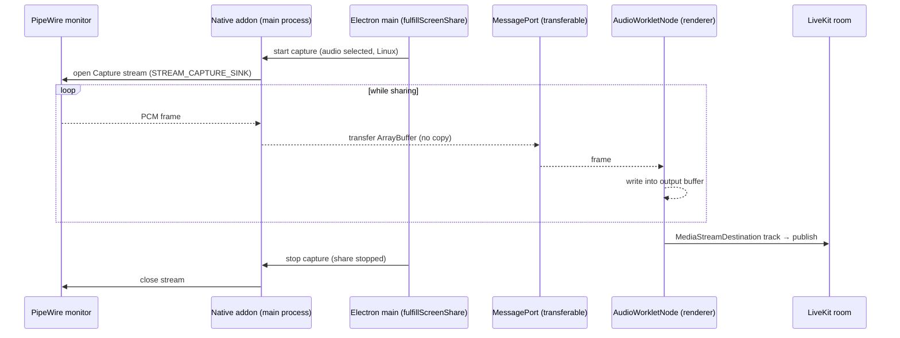

# Design

## Context

`frontend/electron/main.ts`'s `fulfillScreenShare` (~line 587-617) only adds `audio: "loopback" as const` to the `Electron.Streams` callback when `request.audioRequested && process.platform === "win32"`; on Linux it returns video-only. `desktopCapturer.getSources({types:["screen","window"]})` supplies the video source either way. See proposal.md for why the API-only route (`getDisplayMedia`) is closed off: zero audio tracks returned with no error, and Chromium's own Linux picker UI restricts audio sharing to Chrome Tab only.

Verified on this project's dev host (Fedora 44, KDE, Wayland): a running PipeWire monitor source exists (`pactl list sources`), but `pipewire-devel` (the `libpipewire-0.3` headers/pkg-config file needed to build against it) is **not installed** — any build machine needs it added. No native addon infrastructure exists in this repo today: no `binding.gyp`, no `.node` files, no `node-gyp`/`prebuild`/N-API dependency in `frontend/package.json`. `frontend/electron-builder.yml`'s `linux:` block has no `arch:` list, so the current AppImage is effectively single-architecture (the build host's arch, in practice x64) — this change does not change that.

The Linux AppImage that users actually install is built by `.github/workflows/desktop-release.yml`'s `linux` job (`runs-on: ubuntu-latest`), triggered on `workflow_dispatch` and on `v*` tags — not by a manual/ad-hoc build. That job must install `libpipewire-0.3-dev` via `apt-get` and provide a working Rust toolchain before this change's native addon can build there; neither step exists in that workflow today.

`backend/` is already entirely Rust (Axum, SQLx, `livekit-api`) — this change is not introducing Rust to the project, only to the frontend/Electron build pipeline, which has never compiled Rust before.

The renderer processes (`contextIsolation: true`, `nodeIntegration: false`, confirmed for both the main window and the `CallPopoutWindow`) have no native-module access; only the Electron **main** process can load a native addon. The captured audio therefore has to cross from main to renderer before it can become a `MediaStreamTrack` LiveKit can publish — unlike the Windows `audio: "loopback"` path, which Chromium resolves entirely inside the renderer's own `getDisplayMedia` call with no IPC hop.

Per `add-linux-screen-share-system-audio/proposal.md`'s Outcome, Discord's Linux client proves the general approach (native PipeWire capture, bypassing Electron/Chromium's screen-share audio path entirely) ships in production for whole-desktop audio — but gives no public implementation detail to copy directly.

## Goals / Non-Goals

**Goals:** capture whole-desktop system audio on Linux via a native PipeWire addon when screen-share audio is selected; publish it as a LiveKit track alongside the existing screen-share video, bound to the same start/stop lifecycle; fail silently to video-only when the addon is missing, fails to build for the running platform, or fails to capture/publish at runtime; never block app launch, screen sharing, or the Windows/macOS paths.

**Non-Goals:** X11 support (no X11 target exists for this app; out of scope per product decision). Per-window/per-app audio isolation (Discord doesn't ship this either; needs a portal extension that doesn't exist). Multi-architecture Linux builds (out of scope; today's AppImage is single-arch and this change doesn't change that — revisit if/when arm64 Linux is targeted). Building a new CI pipeline from scratch — one already exists (`.github/workflows/desktop-release.yml`); this change only needs to extend its existing `linux` job, not invent a new one.

## Decisions

### D1. Build the addon in Rust via `napi-rs`, against the `pipewire-rs` crate — not hand-written C++, not an existing niche npm package

`napi-rs` produces genuine N-API bindings, which are ABI-stable across Node/Electron versions implementing the same N-API level — the addon needs rebuilding per OS/architecture, not per Electron version, unlike a V8-ABI addon (e.g. built with `nan`). `pipewire-rs` is the PipeWire project-adjacent Rust binding (used by other PipeWire tooling); it gives memory-safe access to `pw_stream`/`pw_context`/`pw_core` without hand-written C FFI. The project's own backend is already entirely Rust, so this is not new language adoption — it's a new Linux build-time dependency for the frontend/Electron build pipeline specifically (including its CI job), documented in tasks.md.

*Alternatives rejected:*
- Hand-written C/C++ N-API addon directly against `libpipewire` via `node-gyp`: more surface for memory-safety bugs in exactly the kind of long-lived native audio-thread code that's hardest to debug from a thin wrapper, for no benefit over the Rust route.
- Depend on an existing npm package (`node-pipewire`, `pw-client`): both exist but neither has a publicly confirmed, documented capture/monitor-source API as of this writing — `node-pipewire`'s shown examples only enumerate nodes, and `pw-client`'s shown quick-start is output-stream-oriented. Taking on an unaudited, early-stage native package as a production dependency for this capability carries real supply-chain and reliability risk for unconfirmed capability. Revisit only if a maintainer confirms capture support and the project earns enough adoption/review to trust.

### D2. Load `libpipewire` as a soft runtime dependency, not a hard link-time one

The addon dynamically loads PipeWire at first use (when a Linux screen share with audio is actually started), not at Electron app launch. A host without a usable PipeWire session (library missing, daemon not running) fails only that capture attempt — app launch and video-only screen sharing are unaffected. This directly implements the spec delta's "Linux native capture is unavailable or fails" scenario.

### D3. Bridge captured PCM from the main process to the renderer via IPC into a Web Audio `AudioWorkletNode`, then publish via `MediaStreamDestination`

The native addon runs in the Electron main process (only place with native-module access) and captures raw PCM frames from the PipeWire monitor. Those frames cross to the renderer via `ipcRenderer.postMessage`/`MessagePort` with transferable `ArrayBuffer`s — not the plain `ipcRenderer.send`/`.invoke` pattern `frontend/electron/preload.ts` uses for its existing (small, infrequent) control messages, which copies payloads via structured clone. A dedicated `MessagePort`, handed off once per capture session, avoids paying a copy per audio frame for this continuous, high-frequency data. In the renderer, an `AudioWorkletNode` (not the deprecated `ScriptProcessorNode`) receives frames over that port, writes them into its output, and connects to a `MediaStreamAudioDestinationNode`; `destination.stream.getAudioTracks()[0]` is the `MediaStreamTrack` published into the LiveKit room, torn down with the rest of the screen-share audio lifecycle exactly like today's Windows loopback track. The codebase already uses `AudioContext`/`GainNode`/`MediaElementAudioSourceNode` for the existing >100% remote-volume boost path, so synthesizing a track from a Web Audio graph is a precedented pattern here, just in the opposite direction (synthesizing a source instead of processing one).

*Alternative rejected:* there is no way to hand a main-process-captured stream directly into `setDisplayMediaRequestHandler`'s callback the way `audio: "loopback"` does — that string is a Chromium-internal keyword resolved entirely inside the renderer, not an extension point for arbitrary native audio sources. The IPC-to-WebAudio bridge is the only way to turn out-of-renderer-process PCM into a publishable `MediaStreamTrack`.

### D4. Prototype the IPC/AudioWorklet bridge before full integration, scoped narrower than the old change's D1

Unlike the previous change, whether PipeWire capture itself works is no longer in question (proven externally by Discord and by this project's own `pactl` evidence). What's unverified in this codebase is the IPC→AudioWorklet→`MediaStreamTrack` plumbing's latency and glitch behavior under real call conditions. Build a minimal prototype (synthetic or looped-back PCM frames end-to-end through the real pipeline) and confirm audible, low-glitch output on a live call before wiring it into the full screen-share flow. If the prototype reveals unacceptable latency/jitter, revisit the bridging approach (e.g. a tighter buffering strategy) before proceeding — do not ship a glitchy audio path.

### D5. Package only for the AppImage's current (single, x64) target architecture; build the native binary ahead of time, never on the end-user's machine

`frontend/electron-builder.yml`'s Linux target has no `arch:` list today; this change does not add multi-arch support. The addon is compiled during the project's own build (`electron:build`) or a dedicated build step — never via a `postinstall` native compile on the end-user's machine, since the AppImage is a pre-built, self-contained artifact end users just run. Build on a Linux image with an old-enough glibc baseline to run across the distros this app's users are likely to have (mirrors the general "manylinux"-style portability concern for prebuilt native Linux binaries), documented concretely once the first build is produced.

## Risks / Trade-offs

- [IPC-bridged audio has no Chromium-internal fast path like Windows loopback does; the extra main→renderer hop risks latency/jitter/underruns that a remote listener would hear as glitches] → D4's prototype gate requires audible, low-glitch verification before full integration; if it fails, revisit buffering/transport before shipping, don't ship best-effort.
- [`pipewire-devel` is not installed on this project's own dev machine today, and the existing `.github/workflows/desktop-release.yml` Linux job doesn't install it or guarantee a Rust toolchain either] → document the exact setup package (Fedora: `pipewire-devel`; note the equivalent for other distros maintainers might build on) in tasks.md/README, extend that workflow's `linux` job with the same setup, and require a successful build through that exact workflow (not just locally) before this change is considered complete.
- [Introducing Rust/`napi-rs`/`cargo` as a new Linux build-time dependency is a first for this repo] → scope the addon narrowly (capture + frame delivery only, no broader PipeWire feature surface), and document the new toolchain requirement explicitly rather than assuming it's already available.
- [A host's PipeWire session may reject or silently drop the capture (sandboxed Flatpak/Snap audio policies, unusual desktop audio setups) in ways this design can't enumerate upfront] → treat every failure mode as the existing "capture unavailable or fails" fallback (video-only, no blocking error), never assume success.
- [Single-arch packaging means this change does nothing for arm64 Linux users, if any exist today or later] → explicitly out of scope (Non-Goals); revisit as its own follow-up if it becomes a real request, not silently assumed away.
