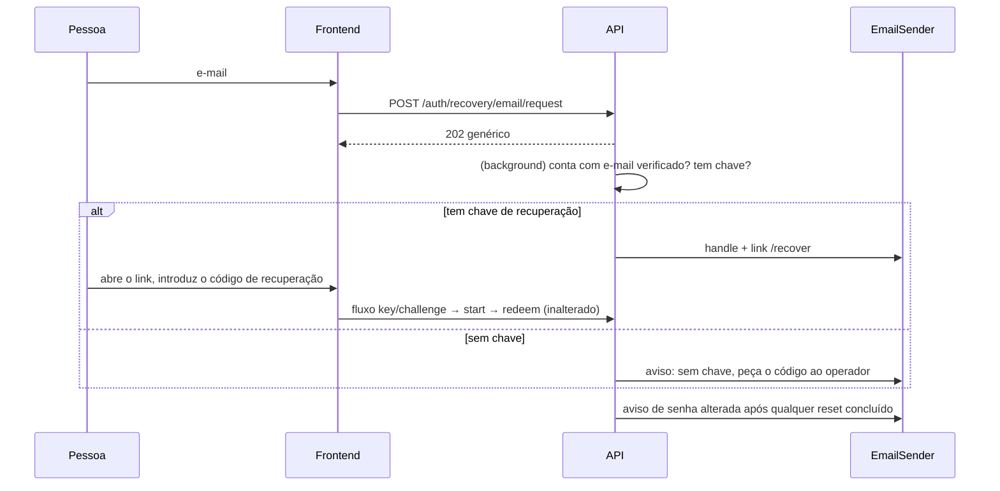

# Design

## Context

`backend/src/api/auth/recovery.rs` oferece reset por código do operador (`/auth/recovery/code/redeem`, cria nova identidade) e `recovery_key.rs` o fluxo por chave (`challenge` → `start` → `redeem`, prova por assinatura Ed25519, preserva a identidade); ambos acabam em `finish_credential_change`. A tela `frontend/src/pages/Recover.tsx` tem os dois caminhos. Substituir a identidade dispara `key_handoff.requested` e `handleHandoffEvent` (`frontend/src/crypto/keyHandoff.ts`) **entrega automaticamente** as chaves de servidor à nova chave pública: por isso qualquer reset que crie identidade nova tem de ser validado por um humano (o operador). A change `email-registration` fornece `EmailSender`, `account.email*`, `RealClientIp`, os baldes de e-mail e `TRUSTED_PROXY`. Ver proposal.md e `review-architect.md`/`review-fullstack.md`.

## Goals / Non-Goals

**Goals:**
- Permitir começar a recuperação só com o e-mail e sem lembrar o handle.
- Não criar nenhuma nova forma de autorização de reset.

**Non-Goals:**
- Reset por e-mail sem chave; token de reset; alterar `key/*`, `CredentialWrite` ou o handoff.
- Adicionar e-mail a contas existentes (não necessário: a instância será reiniciada sem contas).

## Fluxo

## Decisões

1. **O e-mail só encaminha, não autoriza.** O link não leva token; a prova continua a ser a assinatura da chave de recuperação (`key/*` inalterado). *Alternativas rejeitadas:* token de e-mail que permite reset com identidade nova — os clientes online entregariam as chaves de servidor automaticamente a quem controla a caixa de e-mail (`keyHandoff.ts`), anulando o gate humano do operador; token como segundo factor obrigatório de `key/*` — seria contornável pelo caminho antigo sem token, logo sem ganho de segurança, e alteraria um endpoint já especificado; período de espera com aprovação de handoff — exige reescrever o handoff para todo o produto.
2. **Endpoint único** `POST /auth/recovery/email/request {email, hp?, captcha_token?}`: `202 {"ok": true}` sempre; limites por IP (`RealClientIp`) e por e-mail canonicalizado; honeypot silencioso; trabalho em background com envio depois de qualquer acesso à base. Só contas com `email_verified_at` recebem e-mail.
3. **Link com o handle no fragmento** (`PUBLIC_BASE_URL/recover#handle=…`): o handle não é secreto, mas o fragmento evita-o nos logs do proxy e permite à tela escolher o caminho «chave» e preencher o campo. Sem outro estado no servidor.
4. **Aviso pós-reset** disparado depois do commit em `redeem_code` e em `key/redeem` (não em `change_password`, que é alteração com sessão). Reutiliza o `EmailSender`; falhas de envio não afectam o reset.
5. **Contas sem chave** recebem um e-mail informativo; o texto remete para o operador e para a criação da chave. Isto não revela nada que a conta já não saiba.
6. **Flag `RESET_EMAIL`** (padrão desligada) em `Config`, para activar o endpoint independentemente do modo de registo.

## Risks / Trade-offs

- [Quem não tem chave continua dependente do operador] → intencional; o `email-key-reminders` incentiva criar a chave.
- [Enumeração] → resposta e tempos uniformes; e-mail só vai para o dono da caixa.
- [Phishing a imitar o e-mail] → o e-mail liga apenas a `PUBLIC_BASE_URL`, nunca pede senha nem código.
- [Abuso para enviar e-mail a terceiros] → limites por IP e por e-mail, corpo fixo.

## Migration Plan

Sem migração. Activar `RESET_EMAIL=true` depois de `email-registration` activo. Rollback: `RESET_EMAIL=false`.

## Open Questions

- Texto final dos e-mails; não altera specs.
