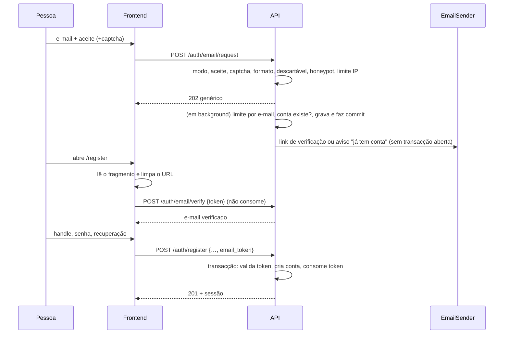
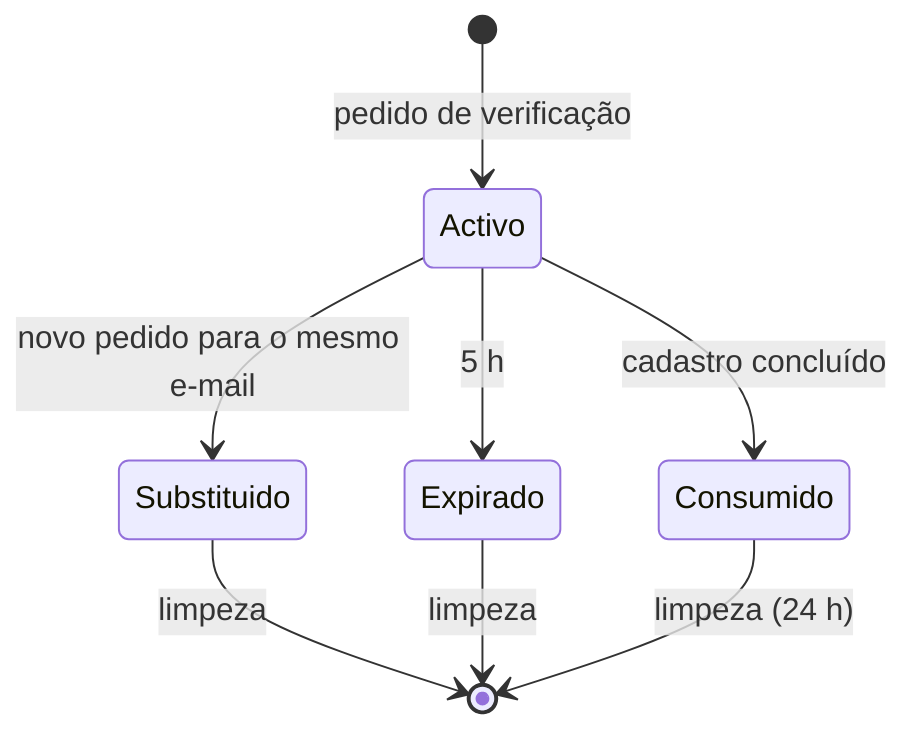

# Design

## Context

O cadastro actual (`backend/src/api/auth/register.rs`) recebe handle, senha, `identity_pubkey`, `identity_vault` (cifrado no cliente a partir da senha) e, opcionalmente, o vault de recuperação e o código de convite; a partir da segunda conta o convite é obrigatório. A tabela `account` não tem e-mail. O limitador (`rate_limit.rs`) é em memória, por IP do peer TCP (`X-Forwarded-For` ignorado), e atrás do Nginx todos os pedidos chegam como `127.0.0.1` (`docs/deploy-producao.md`). `reqwest` com `rustls-tls` já é dependência. Backend: axum + sqlx/SQLite, migrações em `backend/migrations` (última `0025`), `Config` construído também por literal em `backend/src/token/mod.rs` e `backend/tests/contract/production_boot.rs`. Frontend: `frontend/` (Solid, SPA e Electron), sem framework de teste de componente — a verificação é `tsc`, `eslint`, `scripts/verify-*.mjs` e `test:contracts`. Ver proposal.md para a motivação e o `interactive-map` (`registo-autonomo`) como referência.

Diferença central face ao `interactive-map`: lá o link leva a «definir senha» numa conta pendente. Aqui a senha deriva o vault E2E no cliente, logo o servidor não pode criar uma conta sem chaves. Por isso o e-mail é provado **antes** da conta existir.

## Goals / Non-Goals

**Goals:**
- Reutilizar o formulário e o endpoint de cadastro actuais; a novidade é a verificação, o envio, o modo e o antispam.
- Nenhum caminho do pedido permite enumerar e-mails.
- O token nunca chega a logs de proxy.
- Falhar cedo no arranque quando o modo `aberto` seria inseguro ou inútil.

**Non-Goals:**
- Recuperar senha/vault por e-mail, página de contato, e-mail em contas existentes, e-mail de convite.
- Fila externa de envio; aprovação manual de contas; cotas ou restrição de criação de servidor no modo `aberto`.
- Alterar o IP usado pelos limitadores de login/registo existentes.
- Tornar o e-mail obrigatório no modo `fechado`.

## Fluxo

## Decisões

1. **Sem conta pendente; verificação em tabela própria.** `email_verification(id, email, email_canonical, token_hash, expires_at, consumed_at, created_at)`, índice em `email_canonical` e em `token_hash`. Um novo pedido para o mesmo canónico põe `expires_at = agora` nos anteriores activos. *Alternativa:* conta pendente sem chaves — rejeitada, obrigaria a relaxar `identity_pubkey NOT NULL` e a gerir estados de conta.

2. **Token: 32 bytes aleatórios em hex, guardado como SHA-256** (mesmo `hash_token` das sessões), enviado no **fragmento** do link (`PUBLIC_BASE_URL/register#email_token=…`). O frontend lê `location.hash`, valida por `POST /auth/email/verify` (token no corpo) e limpa o URL com `history.replaceState`. *Alternativas rejeitadas:* token em query (`?email_token=`) — chega ao access log do Nginx e ao `Referer`; token no caminho — idem; token num cookie definido pelo servidor — exigiria um passo servidor para o link e complica o cliente desktop. Pelo mesmo motivo, a validação é `POST` e não `GET ?token=`.

3. **E-mail na conta.** Colunas anuláveis `email`, `email_canonical`, `email_verified_at`, `terms_accepted_at` em `account` e índice **único parcial** em `email_canonical WHERE email_canonical IS NOT NULL`. Contas antigas ficam com nulos. O índice é a garantia final contra a corrida de dois cadastros; a violação é mapeada para `409 email_taken` (a transacção reverte, o token não é consumido). O e-mail só entra em `AuthAccount` (resposta própria); nenhuma outra estrutura de resposta, lista ou evento WS o inclui.

4. **`register_inner` ganha `email_token` opcional, com ordem de erros fixa.** Ordem: (1) limite de IP 429; (2) validação do corpo 400; (3) token inválido `400 email_token_invalid`; (4) regra de acesso — primeira conta livre; senão convite válido, ou (modo `aberto` e token válido); convite fornecido e inválido recusa 403 com a mensagem actual mesmo com token; (5) handle existente 409 como hoje; (6) e-mail já associado `409 email_taken`. A validação e o consumo do token (`UPDATE … SET consumed_at WHERE consumed_at IS NULL`, exigindo 1 linha) ocorrem dentro da transacção `BEGIN IMMEDIATE` existente, depois do passo 6. Membership, welcome e handoff de chaves só correm se houver convite. Códigos de erro estáveis: `registration_closed`, `terms_required`, `email_invalid`, `email_domain_blocked`, `captcha_failed`, `email_token_invalid`, `email_taken`.

5. **Resposta genérica com trabalho em background.** `POST /auth/email/request` valida de forma síncrona só o que não toca em contas (modo, aceite, captcha, formato, descartável, honeypot, limite por IP) e devolve sempre `202 {"ok": true}`; honeypot preenchido devolve o mesmo 202 sem enviar (não ensina o bot). Limite por e-mail, consulta de conta, escrita e envio correm numa `tokio::spawn`. A tarefa grava e faz **commit antes** de chamar o provedor (nunca segura transacção durante HTTP). Conta existente → e-mail de aviso, sem token. *Alternativas rejeitadas:* envio síncrono — o tempo de resposta denunciaria os caminhos novo/existente e o 202 ficaria preso à latência do Resend; tabela de saída (outbox) com reenvio — durabilidade desnecessária para um e-mail que a pessoa pode pedir de novo. *Trade-off aceite:* um reinício do processo entre o `202` e o envio perde esse e-mail.

6. **Canonicalização** em função pura testada: minúsculas; remove `+etiqueta`; em `gmail.com`/`googlemail.com` remove pontos e usa `gmail.com`. O e-mail original (minúsculas) fica em `account.email`.

7. **IP do cliente e limites.** Novo extractor `RealClientIp`, usado só pelos novos endpoints: com `TRUSTED_PROXY=true` e peer TCP em loopback, usa `X-Real-IP` (se for um IP válido); caso contrário, o peer TCP. Os limitadores existentes (`ClientIp`) ficam intocados. Novos baldes no `RateLimiter`: `email_request` por IP (ex.: 5/hora) e por e-mail canonicalizado (ex.: 3/hora), mesmas estrutura e `MAX_BUCKETS`; `MESA_RATE_LIMIT_DISABLED` continua a desligá-los nos testes. Como defesa adicional o runbook traz `limit_req` no Nginx para `/api/auth/email/`. Instância de processo único: o limite em memória é por processo. *Alternativas rejeitadas:* limite só no Nginx — o balde por e-mail canonicalizado só a aplicação conhece; ler `X-Forwarded-For` sempre — falsificável; tabela SQLite de contadores — escrita extra em cada pedido público sem ganho com um só processo.

8. **Turnstile opcional.** Com `TURNSTILE_SECRET` definido, o pedido exige `captcha_token`, verificado por `reqwest` em `challenges.cloudflare.com/turnstile/v0/siteverify`. `TURNSTILE_SITE_KEY` sai em `GET /auth/register/config` (`{mode, turnstile_site_key}`), usado também pelo frontend para saber se mostra o pedido de e-mail.

9. **`EmailSender` como trait** (`async fn send(&self, to, subject, html, text)`), com `ResendSender` (POST `https://api.resend.com/emails`, Bearer, timeout curto, nunca propaga erro) e `LogSender` (escreve o conteúdo no log e, se `EMAIL_LOG_FILE`, num ficheiro). Escolha por configuração: `EMAIL_API_KEY` presente → Resend; ausente → Log. Guardado em `AppState` como `Arc<dyn EmailSender>`. Nos testes o `TestApp` constrói o `LogSender` com `EMAIL_LOG_FILE` num diretório temporário e expõe um helper que lê o último link; o `ResendSender` aceita uma URL base configurável para testar contra um servidor local falso. **Logs de diagnóstico** (sem e-mail nem token): finalidade (`verify`|`notice`), estado HTTP do provedor, id do envio devolvido e os 8 primeiros hex do SHA-256 do canónico.

10. **Configuração e segredos.** `Config` ganha os campos novos; segredos (`EMAIL_API_KEY`, `TURNSTILE_SECRET`) usam um tipo `Secret` cujo `Debug` imprime `***`. Os literais de `Config` em `token/mod.rs` e `production_boot.rs` passam a incluir os campos novos. **Validação de arranque:** `REGISTO_MODO` inválido → erro; modo `aberto` + `production` exige `EMAIL_API_KEY`, `EMAIL_FROM`, `PUBLIC_BASE_URL` HTTPS não-localhost e `TRUSTED_PROXY=true`, no padrão de `production_boot.rs`.

11. **Domínios descartáveis:** lista estática embutida (`include_str!`) mais ficheiro opcional `REGISTO_DOMINIOS_BLOQUEADOS`. *Alternativa:* API externa — rejeitada (latência/dependência).

12. **Limpeza:** `tokio::spawn` no arranque (ao lado de `spawn_stale_occupancy_sweeper`) a cada 15 min apaga `email_verification` expiradas ou consumidas há >24 h; erros são logados, a tarefa não morre. Idempotente.

13. **Frontend.** Novo componente `auth/EmailRequest.tsx` (aceite, honeypot oculto, Turnstile se houver, mensagem genérica) usado por `pages/Auth.tsx` quando `GET /auth/register/config` diz `aberto`. Com `#email_token`, `Auth.tsx` valida o token, mostra o e-mail fixo, envia `email_token` no cadastro e limpa o URL; token inválido mostra erro e volta ao pedido. O fluxo por convite fica como está. `RegisterBody`, `session.register` e `api/endpoints/auth.ts` ganham os campos opcionais. **Desktop (Electron):** o pedido de e-mail aparece também no cliente desktop (a instância já está configurada), o link do e-mail abre no navegador (`PUBLIC_BASE_URL`), o cadastro termina na web e a pessoa entra depois no desktop com handle e senha (o vault está no servidor); sem deep link nesta change.

14. **Criação de servidor no modo `aberto`.** `POST /servers` continua a exigir só autenticação; não se acrescenta restrição nem cota nesta change (aditiva). O risco de disco/anexos por contas novas fica registado e o rollback é `REGISTO_MODO=fechado`.

## Risks / Trade-offs

- [Entregabilidade] → domínio verificado no Resend (SPF/DKIM) e DMARC; remetente fixo `EMAIL_FROM`.
- [Limite diário do plano Resend] → envios falham de forma silenciosa para o cliente; o log mostra. Declarar a meta de registos/dia e subir de plano antes de abrir.
- [Abuso para enviar e-mail a terceiros] → limites por IP e por canónico, captcha, corpo do e-mail fixo sem texto livre.
- [`TRUSTED_PROXY` mal configurado] → só vale com peer em loopback; arranque exige-o no `aberto` em produção; runbook confirma que a porta 8080 não está exposta (`BIND=127.0.0.1`).
- [Limite por e-mail silencioso] → a confirmação manda verificar o spam e tentar mais tarde.
- [Envio perdido em reinício] → a pessoa pede de novo; ver Decisão 5.
- [Registo aberto sem cotas] → qualquer conta verificada cria servidores e anexos; não divulgar amplamente antes de haver cotas; rollback imediato para `fechado`.
- [Contas sem servidor] → o shell já tem o estado vazio `noServers`; confirmar o fluxo de aceitar convite com conta existente.
- [Limite em memória, por processo] → válido enquanto houver um processo; registado no runbook.
- [E-mail em claro num produto E2EE] → só devolvido à própria conta; entra no inventário de metadados em claro e na política de privacidade.
- [Token no fragmento] → nunca enviado ao servidor; uso único, 5 h; URL limpo pelo frontend.

## Migration Plan

1. Migração `0026` aditiva (tabela + colunas nulas + índice único parcial). Com `REGISTO_MODO` ausente nada muda.
2. Configurar Resend (`EMAIL_API_KEY`, `EMAIL_FROM`, `PUBLIC_BASE_URL`), `TRUSTED_PROXY=true`, o trecho Nginx (`proxy_set_header X-Real-IP $remote_addr;`, `limit_req` em `/api/auth/email/`), opcionalmente Turnstile.
3. Validar entrega ponta a ponta com `REGISTO_MODO=aberto` numa instância de teste, com dois IPs distintos.
4. Activar `aberto` em produção.
- Rollback: `REGISTO_MODO=fechado`. As colunas ficam sem uso; sem downgrade necessário.

## Open Questions

- Texto final de termos/privacidade referido no aceite (quem responde pelo produto); a change só regista o instante de aceite. Bloqueia a **activação** do modo `aberto` em produção, não a implementação.
