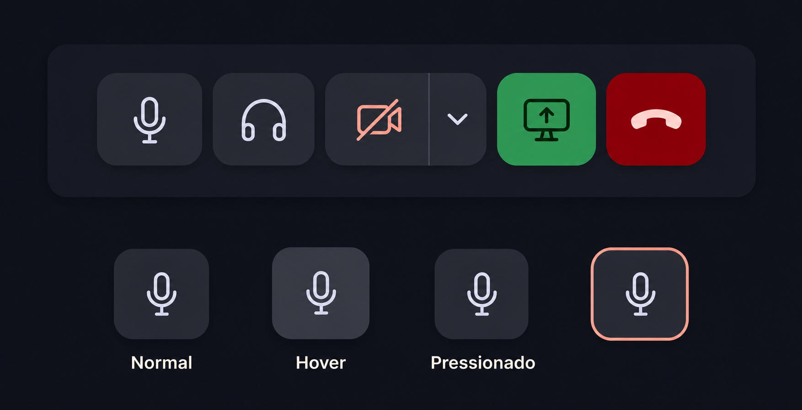

# Proposta visual e técnica — controles de chamada

[Imagem conceitual original](./conceito.png). A versão acima aproxima a paleta, mas é uma ilustração gerada: os valores exatos para implementação são os tokens abaixo.

## Objetivo

Deixar os controles mais limpos e dar resposta visual imediata ao passar o cursor, pressionar e mudar o estado da chamada. A imagem é uma referência de direção visual, não uma captura da interface implementada. As cores devem vir dos tokens existentes em `frontend/src/tokens.css`, que refletem `docs/v2/campfire_modernism/DESIGN.md`.

## Encaixe na paleta do Parley

| Uso | Token | Tema escuro | Tema claro |
| --- | --- | --- | --- |
| Fundo do painel | `--surface-container-low` | `#181b24` | `#f4efeb` |
| Botão neutro | `--surface-container-high` | `#272a33` | `#e8e1d9` |
| Hover neutro | `--surface-container-highest` | `#32343e` | `#ded6ce` |
| Ícone neutro | `--on-surface` | `#e0e2ef` | `#211b19` |
| Ícone desligado/silenciado | `--error` | `#ffb4ab` | `#ba1a1a` |
| Compartilhamento ativo | `--secondary-container` / `--on-secondary-container` | `#2ca464` / `#003118` | `#b8f0cb` / `#103b25` |
| Encerrar chamada | `--error-container` / `--on-error-container` | `#93000a` / `#ffdad6` | `#ffdad6` / `#410002` |
| Foco de teclado | `--primary` | `#ffb4a1` | `#87351f` |

Usar os nomes dos tokens, não os valores hexadecimais, na implementação. O verde e o vermelho da imagem revisada ainda podem parecer mais intensos que os valores definidos; a tabela é a referência fiel para a revisão técnica. Evitar brilho luminoso na borda de foco: o design system privilegia conforto em uso prolongado e acentos quentes contidos.

## Composição

- Botões principais de 40 × 40 px, cantos de 12 px (`--radius-md`), ícones de aproximadamente 20 px e espaço de 6 px entre controles. Ajustar a dimensão quando o painel disponível for estreito.
- Superfície neutra do tema para ações comuns, com borda sutil e sombra curta. Evitar que cada botão pareça um bloco colorido independente.
- Configurações da câmera em um botão secundário acoplado ao botão da câmera, separado por um divisor fino.
- Encerrar chamada como ação visualmente distinta, com o par semântico de erro. Manter distância suficiente dos controles de alternância para reduzir cliques acidentais.

## Estados

| Estado | Tratamento proposto |
| --- | --- |
| Normal | Superfície neutra, ícone claro e contraste consistente. |
| Hover | Superfície ligeiramente mais clara, sombra um pouco mais forte e elevação de cerca de 1 px. |
| Pressionado | Deslocamento para baixo de cerca de 1 px, redução sutil de escala e sombra interna curta. |
| Foco pelo teclado | Contorno externo de 2 px, separado do botão, visível em temas claro e escuro. |
| Desligado ou silenciado | Ícone riscado e cor de alerta; o estado deve continuar compreensível sem depender só da cor. |
| Compartilhamento ativo | Fundo verde discreto e ícone de alto contraste. |
| Indisponível | Menor contraste, sem hover ou resposta de clique, mantendo a explicação acessível. |

## Comportamento e acessibilidade

- Transições rápidas, em torno de 120–160 ms, para cor, sombra e posição. A resposta ao pressionar deve ocorrer imediatamente.
- Respeitar a preferência de movimento reduzido removendo deslocamento e escala.
- Manter rótulos acessíveis e dicas de ação que descrevam o próximo clique, como “Silenciar microfone” ou “Ativar câmera”.
- Atualizar o estado visual somente de acordo com o estado real da chamada. Se uma operação falhar, o botão deve voltar ao estado anterior e apresentar o erro existente.
- Aplicar a mesma linguagem visual ao painel do usuário e ao player flutuante, adaptando apenas o tamanho quando necessário.

## Referência de implementação futura

Os controles atuais estão em `frontend/src/voice/CallControls.tsx` e `frontend/src/voice/FloatingPlayer.tsx`; os estilos compartilhados estão em `frontend/src/voice.css`. Esta proposta não altera esses arquivos.
